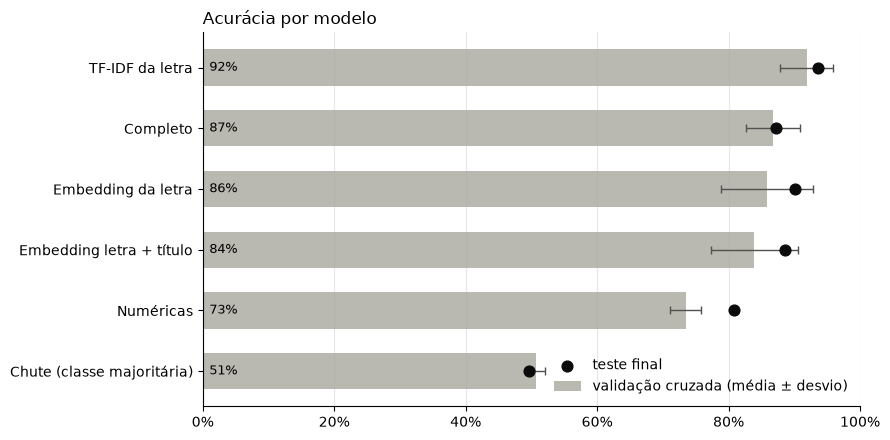
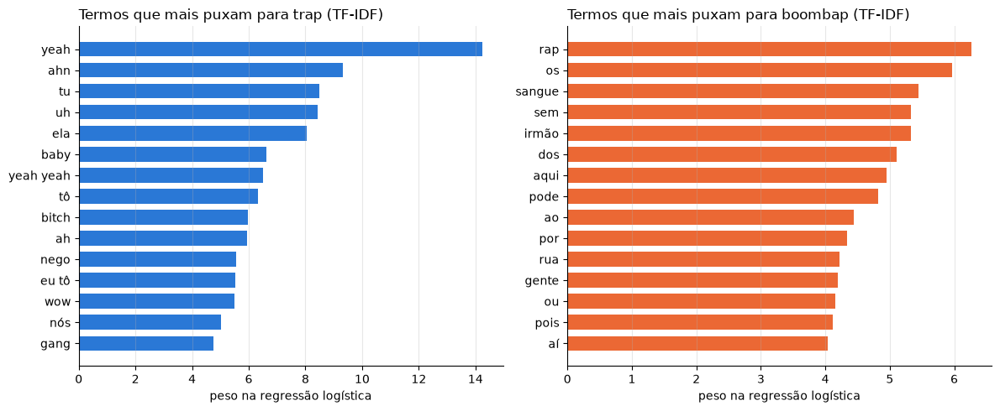
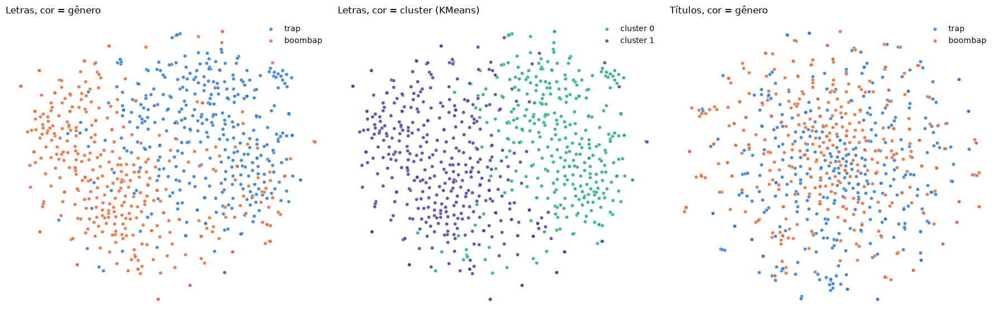

# Trap vs. Boom Bap

**Classificação de letras de rap brasileiro com aprendizado de máquina clássico.**

🇧🇷 Português · [🇺🇸 English](README.en.md)

É possível distinguir trap e boom bap brasileiros **só pela letra**? Este projeto coleta 800 letras de 61 artistas, trata homônimos e ruído da fonte e compara cinco representações de texto, de estatísticas simples a embeddings de um modelo de linguagem. A avaliação é sempre feita em **artistas que o modelo nunca viu**.

<p align="center"></p>

## Resultados

| modelo | acurácia CV (treino) | acurácia teste |
|---|---|---|
| Chute (classe majoritária) | 50,8% | 49,6% |
| Numéricas (tamanho + uso de inglês) | 73,5% ± 2,4 | 80,9% |
| **TF-IDF da letra** | **91,9% ± 4,1** | **93,6%** |
| Embedding da letra (Qwen3) | 85,9% ± 7,0 | 90,1% |
| Embedding letra + título | 83,9% ± 6,6 | 88,7% |
| Completo (embeddings + numéricas) | 86,8% ± 4,1 | 87,2% |

*710 músicas de 58 artistas após o tratamento; teste final com 11 artistas inéditos (141 músicas).*

- **Estilo vence significado.** O TF-IDF, a representação mais clássica, supera os embeddings: o que separa os gêneros é vocabulário e forma (ad-libs, gírias, inglês, conectivos), não o tema.
- **Quatro números já dizem muito.** Tamanho da letra e proporção de inglês chegam a 73,5% na validação cruzada.
- **Dados limpos valem mais que modelo melhor.** Remover dois artistas homônimos (32 músicas com rótulo errado) elevou a acurácia em artistas inéditos de 89,5% para 92,8%.
- **O que sobra de erro é ambiguidade real.** Os erros se concentram em artistas que transitam entre os estilos (Froid, Duzz, Kayblack, Haikaiss), o que aponta para o rótulo por artista, não para o modelo.

<p align="center"></p>

## Metodologia

1. **Coleta:** letras da API pública do [LRCLIB](https://lrclib.net), a partir de listas de artistas de cada gênero (máx. 20 músicas por artista, sem duplicatas). O rótulo vem do artista.
2. **Tratamento:**
   - remoção de homônimos estrangeiros por detecção de idioma **linha a linha** (o rap mistura português e inglês, e a letra inteira engana);
   - remoção de homônimos brasileiros encontrados na análise de erros;
   - limpeza de títulos e marcações como `[Refrão]`.
3. **Variáveis:** tamanho da letra, proporção de palavras estrangeiras (via frequências do `wordfreq`), TF-IDF de unigramas e bigramas e embeddings do [`Qwen/Qwen3-Embedding-0.6B`](https://huggingface.co/Qwen/Qwen3-Embedding-0.6B), que lê a letra inteira sem truncar.
4. **Avaliação sem vazamento:**
   - `StratifiedGroupKFold` **por artista** no teste final e na validação cruzada;
   - TF-IDF e padronização dentro de `Pipeline`;
   - regularização escolhida na validação cruzada, com o teste usado uma única vez.
5. **Uso:** modelo final retreinado com toda a base, com probabilidades calibradas (`CalibratedClassifierCV`) em artistas não vistos.

<p align="center"></p>

## Como executar

Requer Python 3.12+.

```bash
git clone https://github.com/nicollasisaac/trap-vs-boombap.git
cd trap-vs-boombap
python -m venv .venv && source .venv/bin/activate
pip install -r requirements.txt
jupyter nbconvert --to notebook --execute --inplace trap_vs_boombap.ipynb   # ou abra no Jupyter / VS Code
```

O repositório inclui `dataset.csv` e `embeddings.npz`, então o notebook roda de ponta a ponta em poucos minutos, sem coletar letras nem calcular embeddings. Para refazer tudo do zero, apague os dois arquivos. A coleta leva alguns minutos e os embeddings cerca de 10 minutos em GPU. Como o LRCLIB muda com o tempo, uma nova coleta pode produzir números um pouco diferentes.

### Classificando uma música

Depois de executar o notebook:

```python
classificar_musica("LEALL", "Medo de Quase Nada")
# 🎵 LEALL - Medo de Quase Nada
# → BOOMBAP (51%) | trap 49% · boombap 51%
#   puxaram para trap: yeah, tô, eu tô, hoje, eu, nego, hoje eu, ela
#   puxaram para boombap: homem, quase nada, medo, olho, cada, fora, saber, rua
```

`classificar_letra(letra)` faz o mesmo com uma letra colada. As duas mostram o gênero previsto, a probabilidade calibrada e os termos que mais pesaram para cada lado.

## Estrutura

```
trap_vs_boombap.ipynb   notebook completo: coleta, análise, modelos, avaliação e uso
dataset.csv             800 letras coletadas (artista, título, gênero, letra); o tratamento remove 90
embeddings.npz          cache dos embeddings Qwen3 (indexado por hash do texto)
assets/                 figuras usadas neste README
requirements.txt        dependências com versões fixadas
```

## Limitações

- O rótulo vem do artista, não da música; artistas que transitam entre estilos geram ruído.
- O teste final é pequeno (11 artistas): outra semente produziria outra divisão e números alguns pontos diferentes.
- A busca por nome no LRCLIB ainda pode trazer homônimos para artistas novos na lista.

## Dados e direitos autorais

As letras em `dataset.csv` foram obtidas do [LRCLIB](https://lrclib.net) e **pertencem aos seus autores e detentores de direitos**. Elas estão aqui apenas para fins de pesquisa e educação, para que os resultados possam ser reproduzidos. A licença deste repositório **não** se aplica às letras. Se você é detentor de direitos e quer a remoção de algum conteúdo, abra uma issue.

## Licença

Código sob a [licença MIT](LICENSE).
